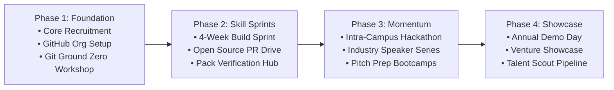

<div align="center">

# 🏛️ UOS ENTREPRENEURSHIP SOCIETY
### UNIVERSITY OF SAHIWAL

[](https://github.com/uos-entrepreneurship)
[](https://github.com/uos-entrepreneurship)
[](https://github.com/uos-entrepreneurship)

<br/>

**ENTREPRENEURSHIP • INNOVATION • TECHNOLOGY**  
*Think. Build. Launch.*

---

**A cross-disciplinary, student-led entrepreneurship and innovation community.**  
Connecting students from all departments with the modern tech, venture, and business ecosystem.

<br/>

[🎯 Mission](#-our-mission) •
[🏛️ What We Do](#-what-we-do) •
[📋 Flagship Programs](#-flagship-programs) •
[🗺️ Roadmap](#-roadmap-20262027) •
[🤝 Roles](#-community-roles) •
[🚀 Get Involved](#-get-involved)

</div>

---

## 🎯 Our Mission

> *"To empower students across disciplines to develop entrepreneurial mindsets, explore emerging technologies, transform ideas into meaningful ventures, and build the skills and connections needed to create real-world impact."*

---

## 🏛️ What We Do

We believe innovation doesn't belong to a single department. Whether you study **Business Administration**, **Computer Science**, **English**, **Economics**, or **Mathematics**, there is a place for you to build and lead.

| Pillar | Focus | What Members Achieve |
| :---: | :--- | :--- |
| 🚀 | **Entrepreneurship** | **Start & Grow Businesses**<br/>Turn raw concepts into validated business models, pitch decks, and viable ventures. |
| 💡 | **Innovation** | **Solve Problems & Develop Ideas**<br/>Apply design thinking, agile execution, and rapid prototyping to campus and regional challenges. |
| 🤖 | **Technology** | **Explore AI, Software & Emerging Tech**<br/>Demystify code, version control, AI systems, full-stack tools, and digital product workflows. |
| 🎤 | **Professional Skills** | **Communication, Sales & Leadership**<br/>Master public speaking, client negotiation, team management, and professional networking. |
| 🌐 | **Opportunities** | **Connect with the Ecosystem**<br/>Bridge the gap with industry founders, alumni mentors, investor networks, and global programs. |

---

## 📋 Flagship Programs

<table>
<tr>
<td width="50%" valign="top">

### 🛠️ Hands-on Tech & Dev Sprints
Practical bootcamps taking students from Ground Zero to practical software development. Covers Git, collaborative version control, open source, and building web/AI products.

</td>
<td width="50%" valign="top">

### 💡 Venture Incubation Tracks
Structured pathways guiding student teams through ideation, market validation, MVP creation, and commercial launch with founder mentorship.

</td>
</tr>
<tr>
<td width="50%" valign="top">

### ⚡ Intra-University Hackathons
High-energy, cross-department build marathons where engineers, designers, and business strategists team up to solve problems and demo live in 48 hours.

</td>
<td width="50%" valign="top">

### 🎙️ Founder Talks & Industry Panels
Interactive masterclasses with entrepreneurs, freelancers, tech leads, and alumni sharing real-world playbooks on client acquisition, remote careers, and startup growth.

</td>
</tr>
</table>

---

## 🗺️ Roadmap (2026–2027)



| Phase | Timeline | Focus Area | Core Deliverables |
| :--- | :--- | :--- | :--- |
| **Phase 1: Foundation** | Q1 | Community Infrastructure | Launch organization hub, onboard founding team, deliver *Git Zero to Hero* workshop. |
| **Phase 2: Skill Sprints** | Q2 | Technical & Business Depth | 4-week product sprint, first contribution drive, student developer pack onboarding. |
| **Phase 3: Momentum** | Q3 | High-Impact Campus Events | Campus-wide Hackathon, venture pitching competition, external industry panels. |
| **Phase 4: Showcase** | Q4 | Incubation & Demo Day | Student Demo Day, seed showcase for student projects, annual society transition. |

---

## 🤝 Community Roles

```
               ┌───────────────────────────────┐
               │    Executive & Core Leads     │
               │  Strategy • Events • Tech Ops │
               └───────────────┬───────────────┘
                               │
               ┌───────────────▼───────────────┐
               │      Project Maintainers      │
               │ Code Reviews • Repos • Tracks │
               └───────────────┬───────────────┘
                               │
               ┌───────────────▼───────────────┐
               │      Active Contributors      │
               │ Workshops • Sprints • Pitches │
               └───────────────────────────────┘
```

* **Core Team & Leads:** Drive operations, event execution, partnerships, and society governance.
* **Project Maintainers:** Oversee organization repositories, review pull requests, and mentor newcomers.
* **General Members & Fellows:** Attend workshops, collaborate in cross-functional teams, and build public portfolios.

---

## 🚀 Get Involved

We follow an open, collaborative standard. Getting involved takes just three steps:

1. **⭐ Follow & Star:** Star our repositories to stay updated with codebases, workshop materials, and templates.
2. **💬 Engage in Discussions:** Connect with fellow students in repository discussions, suggest workshop topics, or pitch an idea.
3. **🛠️ Make Your First Contribution:** Check out our open issues tagged `good first issue` to start contributing.

> 🎓 **Zero Barrier to Entry:**  
> You don't need prior coding experience or a business degree to join. If you have curiosity and drive, you have a place here.

---

<div align="center">

**UOS Entrepreneurship Society**  
*University of Sahiwal — Sahiwal, Punjab, Pakistan*  
📧 Contact: [ashiriftikharofficial@gmail.com](mailto:ashiriftikharofficial@gmail.com) • 🌐 Organization: [github.com/uos-entrepreneurship](https://github.com/uos-entrepreneurship)

<sub>Built with passion by students, for students.</sub>

</div>
