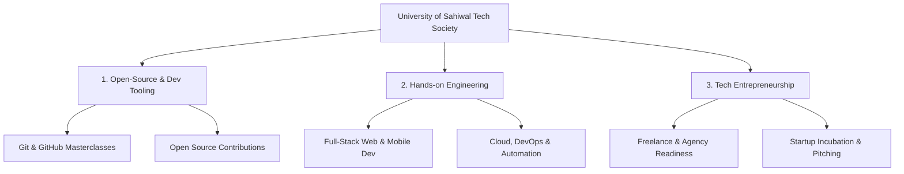

# 🏛️ University of Sahiwal — Tech & Entrepreneurship Society
> **The official student-led innovation, open-source, and developer community at University of Sahiwal.**

---

### 🌐 Welcome to the Hub!
The **University of Sahiwal Tech & Entrepreneurship Society (UOS Tech)** is dedicated to bridging the gap between theoretical classroom knowledge and real-world tech industry standards. We equip students with modern developer tooling, foster an active open-source culture, and incubate student-led entrepreneurial ventures.

```
       __  __ ____  ____     _____         _     
      |  \/  / __ \/ ___|   |_   _|__  ___| |__  
      | |\/| \ \/ /\___ \     | |/ _ \/ __| '_ \ 
      | |  | |>  <  ___) |    | |  __/ (__| | | |
      |_|  |_/_/\_\____/      |_|\___|\___|_| |_|
            Empowering the Next Generation of Builders
```

---

## 🎯 Our Mission & Pillars



1. **🛠️ Open Source & Developer Tooling**
   - Demystifying Git, GitHub, CI/CD, and collaborative version control for every department.
   - Mentoring students to make their first Pull Requests to global open-source projects.
   - Guiding students through developer benefits and student packs.

2. **💻 Modern Engineering & Applied Tech**
   - Practical, project-based bootcamps covering modern web technologies, APIs, backend architecture, and AI-assisted workflows.
   - Team hackathons and peer code reviews simulating agile engineering teams.

3. **🚀 Tech Entrepreneurship & Industry Readiness**
   - Transforming student side-projects into launchable SaaS products, client solutions, and commercial ventures.
   - Direct mentorship on freelancing, remote agency operations, and global client acquisition.

---

## 📅 Roadmap & Initiatives (2026)

| Phase | Milestone | Focus Areas |
| :--- | :--- | :--- |
| **Q1** | **Foundation & Onboarding** | Launch GitHub Org, Core Team recruitment, "Git & GitHub Zero to Hero" workshop |
| **Q2** | **Skill Sprints** | 4-week Full Stack project sprint, Open-source contribution drive |
| **Q3** | **Campus Hackathon** | First annual intra-university hackathon, industry guest speaker sessions |
| **Q4** | **Incubation & Showcase** | Demo Day for student products, student talent scout exhibition |

---

## 🤝 Community Roles & Membership

- **Learners / Members:** Attend workshops, access curated learning tracks, collaborate on community repos.
- **Project Maintainers:** Lead open-source repositories under the organization, review PRs, and guide junior peers.
- **Core Organizing Team:** Coordinate events, logistics, sponsorships, design, and developer relations.

---

## 📌 Getting Involved

1. **Star & Explore Repositories:** Browse our learning resources and project templates below.
2. **Join Discussions:** Participate in GitHub Discussions or our community groups.
3. **Contribute:** Pick up an issue labeled `good first issue` on any of our public repositories.

---

<div align="center">

**Led with ❤️ by Students at University of Sahiwal**  
*In pursuit of official GitHub Campus Program & GitHub Campus Expert accreditation.*

[Report an Issue](https://github.com) • [Request a Workshop](https://github.com) • [Join Community](https://github.com)

</div>
